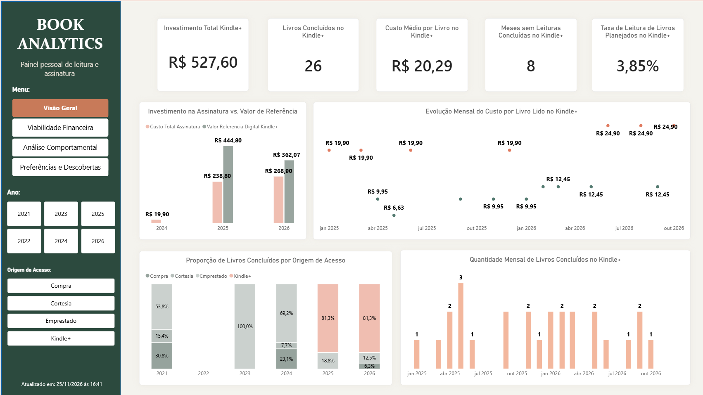
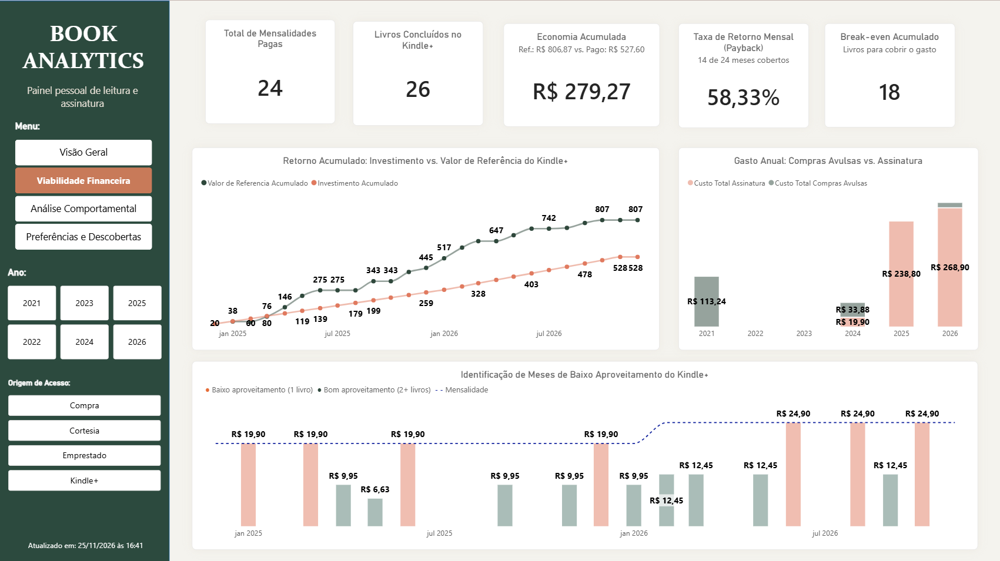
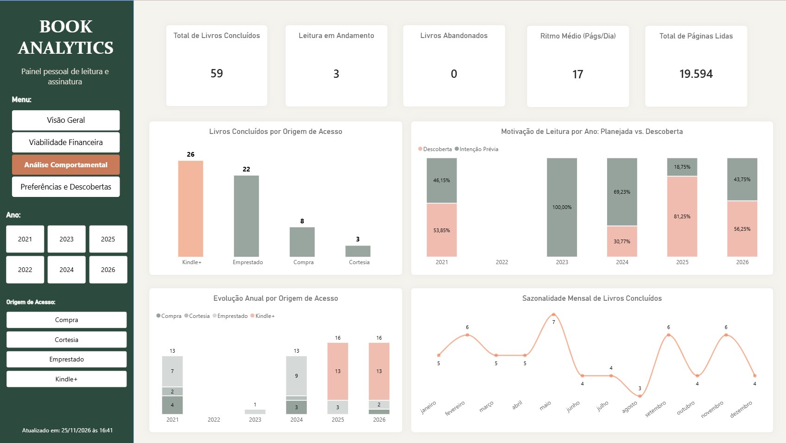
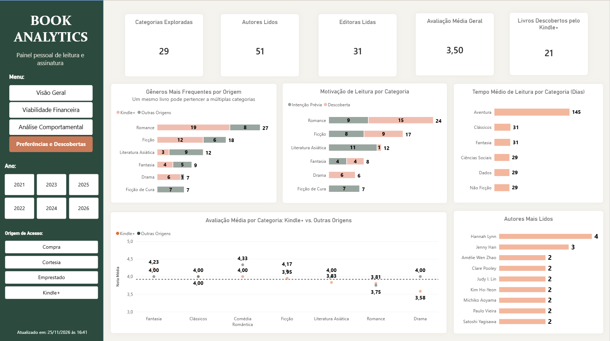
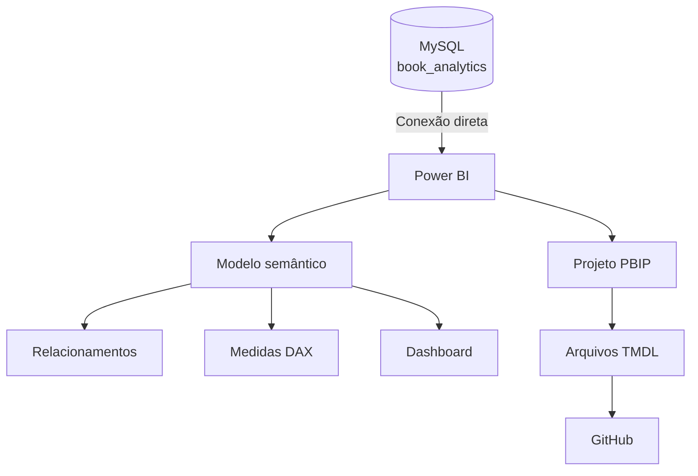

# 📚 Kindle+ Analytics
### Análise financeira e comportamental de leitura com MySQL e Power BI

Projeto de análise de dados desenvolvido para avaliar se a assinatura Kindle+ vale a pena financeiramente e compreender como a disponibilidade de livros influencia meus hábitos de leitura.

A partir de dados pessoais de leitura e do histórico de pagamentos da assinatura, o projeto combina **SQL, modelagem de dados, DAX e visualização de dados** para transformar registros de leitura em informações que apoiam decisões de consumo.

---

## 1. Contexto e objetivo

Assinaturas digitais representam um custo recorrente. Para avaliar se esse investimento faz sentido, não basta observar o valor da mensalidade: é necessário entender a frequência de utilização, os livros acessados e o valor que eles representam em comparação com alternativas de aquisição.

O projeto utiliza meu histórico pessoal de leituras para responder a duas questões principais:

- Vale a pena continuar pagando pelo Kindle+?
- Como a assinatura influencia meu comportamento de leitura?

Além da análise financeira, o estudo busca compreender preferências literárias, frequência de leitura, avaliações e o papel da disponibilidade de livros na escolha das próximas leituras.

### Dashboard

O dashboard foi desenvolvido no Power BI para analisar o aproveitamento financeiro da assinatura Kindle+ e compreender o comportamento de leitura ao longo do tempo.

**[Acesse o dashboard interativo no Power BI](https://app.powerbi.com/view?r=eyJrIjoiMDQwNTM4MWEtMjE2OS00NmYzLWI0NzctODc3NWVjMTllMDlmIiwidCI6IjU3NTI5OTdmLTBkODUtNDI0My04ZjgxLTNiYmZlMTI5ODhjYiJ9)**

### Visão geral


### Análise financeira


### Comportamento de leitura


### Preferências e Descobertas


## 2. Perguntas de negócio

### Análise financeira

- Quanto já gastei com a assinatura Kindle+?
- Como o custo mensal da assinatura evoluiu ao longo do tempo?
- Qual é o valor de referência dos livros lidos que estavam disponíveis na assinatura?
- Em que momento o valor de referência acumulado dos livros supera o custo acumulado da assinatura?
- Qual é o resultado do break-even acumulado?
- Como os custos da assinatura se comparam aos gastos efetivos com livros comprados?
- Qual seria o custo estimado de aquisição avulsa dos livros acessados pela assinatura?

### Comportamento de leitura

- Quantos livros leio por mês e por ano?
- Quantos livros concluo, mantenho em andamento ou abandono?
- Qual é o tempo médio de leitura?
- Qual é a distribuição das leituras por origem de acesso?
- Quantos livros eu já pretendia ler e quantos foram escolhidos sem intenção prévia?
- A disponibilidade de livros no Kindle+ influencia minhas escolhas?
- Quais categorias, autores e editoras fazem parte das minhas preferências?
- Quais livros recebem as melhores avaliações?

## 3. Arquitetura e tecnologias

O projeto utiliza MySQL para armazenamento e organização dos dados e Power BI para modelagem analítica, cálculos e visualizações.

O Power BI conecta-se diretamente às tabelas do MySQL, sem utilização de views intermediárias. Os relacionamentos e cálculos analíticos são realizados no modelo semântico.



### Tecnologias e ferramentas

| Tecnologia | Aplicação |
|---|---|
| MySQL 8.0 | Banco de dados relacional, criação de tabelas, restrições e consultas SQL. |
| SQL | Manipulação, validação e análise dos dados. |
| Power BI | Modelagem semântica, indicadores e dashboards. |
| DAX | Cálculos, KPIs e análises financeiras e comportamentais. |
| Power Query | Conexão e preparação dos dados, quando necessárias. |
| PBIP | Organização do projeto Power BI em arquivos versionáveis. |
| TMDL | Versionamento textual dos metadados do modelo semântico. |
| Git e GitHub | Controle de versão e documentação do projeto. |

## 4. Modelagem de dados

O banco `book_analytics` utiliza uma estrutura relacional composta por dimensões, tabelas fato e uma tabela associativa.

| Tabela | Responsabilidade |
|---|---|
| `dim_livros` | Cadastro dos livros, autores, editoras, páginas e preços de referência. |
| `dim_categoria` | Cadastro das categorias literárias. |
| `livro_categoria` | Associação entre livros e categorias. |
| `fato_leituras` | Registro dos eventos de leitura, datas, origem, formato, motivação, nota e status. |
| `fato_assinatura` | Histórico dos valores mensais da assinatura. |

A tabela `livro_categoria` resolve o relacionamento muitos-para-muitos entre livros e categorias.

A tabela `fato_assinatura` mantém o histórico financeiro da assinatura de forma independente dos eventos de leitura.

### Documentação técnica

- [Diagrama Entidade-Relacionamento](docs/diagrama-er.md)
- [Dicionário de Dados](docs/dicionario_de_dados.md)
- [Modelo Power BI](docs/modelo_power_bi.md)

## 5. Análises e indicadores

O dashboard contempla duas perspectivas principais: desempenho financeiro da assinatura e comportamento de leitura.

### Análise financeira

- Custo mensal e acumulado da assinatura.
- Gastos efetivos com compras de livros.
- Valor de referência dos livros lidos.
- Economia estimada em comparação à aquisição avulsa.
- Break-even acumulado.
- Acompanhamento da meta anual de leitura.

O break-even permite comparar o custo acumulado da assinatura com o valor de referência dos livros acessados. O resultado é uma estimativa comparativa, não uma economia financeira efetivamente realizada.

### Comportamento de leitura

- Quantidade de livros e eventos de leitura.
- Evolução mensal e anual das leituras.
- Distribuição por status, formato e origem de acesso.
- Tempo de leitura.
- Avaliações atribuídas aos livros.
- Intenção prévia de leitura.
- Preferências por autores, editoras e categorias.

As análises consideram filtros temporais e características dos livros para permitir diferentes perspectivas sobre o comportamento de leitura.

## 6. Habilidades aplicadas

**Banco de dados e SQL**
- Modelagem relacional e definição de granularidade.
- Criação de tabelas, chaves primárias e estrangeiras.
- Restrições de integridade (`CHECK`, `UNIQUE`, `NOT NULL`).
- Manipulação e atualização de dados.
- Consultas analíticas e funções de janela.
- Validação e qualidade dos dados.

**Análise de dados e Power BI**
- Modelagem de dados e relacionamentos.
- Construção de medidas DAX.
- Análise financeira e indicadores de desempenho.
- Análise exploratória e segmentação.
- Desenvolvimento de dashboards e visualizações.
- Interpretação de resultados e tradução de dados em perguntas de negócio.

**Engenharia e organização**
- Organização de scripts SQL.
- Documentação técnica e dicionário de dados.
- Versionamento com Git e GitHub.
- Organização de projeto Power BI com PBIP e TMDL.

## 7. Estrutura do repositório

```text
kindle-unlimited-analytics/
│
├── data/
│   ├── tb_assinatura.csv
│   ├── tb_categorias.csv
│   ├── tb_leituras.csv
│   ├── tb_livro_categoria.csv
│   └── tb_livros.csv
│
├── docs/
│   ├── diagrama-er.md
│   ├── dicionario_de_dados.md
│   └── modelo_power_bi.md
│
├── img/
│   ├── 1_visao_geral.png
│   ├── 2_viabilidade_financeira.png
│   ├── 3_analise_comportamental.png
│   └── 4_preferencias_descobertas.png
│
├── power_bi/
│   ├── dashboard_leitura.Report/
│   ├── dashboard_leitura.SemanticModel/
│   └── dashboard_leitura.pbip
│
├── queries/
│   ├── 01_behavior_analysis.sql
│   ├── 02_financial_analysis.sql
│   ├── 03_ranking_segmentation.sql
│   └── 04_advanced_window_functions.sql
│
├── scripts/
│   ├── 1_create_table.sql
│   ├── 2_inserts.sql
│   ├── 3_updates.sql
│   └── 4_data_quality.sql
│
├── .gitignore
└── README.md
```

## 8. Como executar o projeto

### Pré-requisitos

- MySQL 8.0 ou superior.
- Power BI Desktop.
- Git.

### 1. Clonar o repositório

```bash
git clone https://github.com/YumiiOnoue/kindle-unlimited-analytics.git

cd kindle-unlimited-analytics
```

### 2. Criar o banco de dados

No MySQL:

```sql
CREATE DATABASE book_analytics;
```

### 3. Executar os scripts

No MySQL Workbench, execute os scripts na seguinte ordem:

1. `scripts/1_create_table.sql` — cria a estrutura do banco.
2. `scripts/2_inserts.sql` — realiza a carga inicial dos dados.
3. `scripts/3_updates.sql` — aplica atualizações e correções previstas.
4. `scripts/4_data_quality.sql` — executa verificações de qualidade e integridade.

**Importante:** os scripts de criação e carga inicial devem ser executados uma única vez em um banco vazio. O script de atualização deve ser utilizado conforme a necessidade, verificando previamente os registros existentes para evitar duplicidades. O script de qualidade pode ser executado novamente após novas cargas ou atualizações.

### 4. Abrir o Power BI

Abra o projeto `.pbip` disponível na pasta `power_bi/`, configure a conexão com o MySQL e atualize os dados.

Consulte [`docs/modelo_power_bi.md`](docs/modelo_power_bi.md) para entender os relacionamentos, medidas e estrutura do modelo semântico.

## 9. Considerações e limitações

- O valor de referência dos livros representa uma comparação hipotética com a aquisição avulsa, não necessariamente uma economia realizada.
- Os resultados dependem da qualidade e da atualização dos registros pessoais.
- A análise de tempo de leitura depende da disponibilidade e consistência das datas de início e fim.
- A meta anual de leitura é um parâmetro de acompanhamento pessoal, enquanto o break-even representa uma comparação financeira.
- Os indicadores de livros, autores, editoras e categorias devem considerar a granularidade dos eventos de leitura e as associações entre categorias para evitar contagens duplicadas.

---

*Projeto desenvolvido para aplicar técnicas de análise de dados a uma decisão real de consumo, combinando investigação financeira, comportamento de leitura e visualização de dados.*