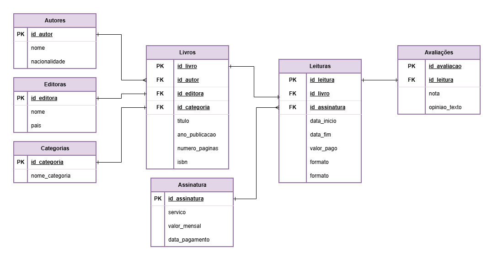
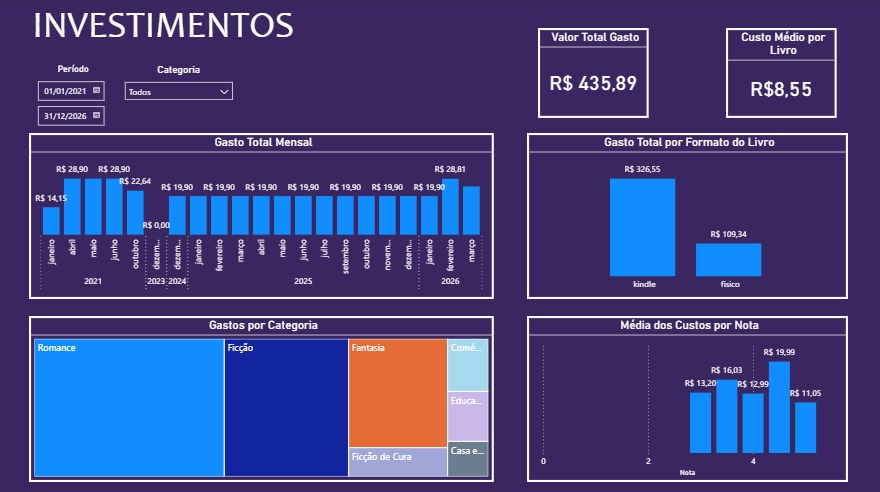

# 📚 Book Analytics: Otimização de Leitura e Assinaturas
Este projeto nasceu de uma necessidade pessoal: analisar meus hábitos de leitura para tomar decisões baseadas em dados. O objetivo principal é verificar a viabilidade financeira da assinatura Kindle Unlimited, monitorar a evolução do meu volume de leitura ao longo dos anos e identificar preferências literárias para otimizar futuros gastos.

## 🎯 Objetivos do Projeto
* **Análise de ROI (Retorno sobre Investimento):** Calcular o custo real por livro lido através da assinatura versus a compra avulsa.
* **Monitoramento de Hábito:** Verificar se a quantidade de livros e páginas lidas aumentou ao longo do tempo.
* **Perfil de Preferências:** Identificar categorias e autores com melhores avaliações para guiar próximas compras.
* **Business Intelligence:** Criar uma base de dados estruturada para alimentar um dashboard no Power BI.

## 🏗️ Estrutura do Banco de Dados
O projeto utiliza um banco de dados MySQL com uma arquitetura de Snowflake Schema (Esquema Floco de Neve) simplificada para facilitar a análise:

* **Tabelas Dimensionais:** autores, editoras, categorias, livros e assinatura.
* **Tabelas Fato:** leituras (registra o evento da leitura e formato) e avaliacoes (registra a performance subjetiva).

## 📊 Insights Analíticos (Queries Principais)
O repositório contém scripts SQL avançados para extrair indicadores como:
* **Custo Efetivo por Livro:** Localizado em 02_financial_analysis.sql, esta consulta divide o valor da mensalidade do Kindle Unlimited pelo número de livros lidos no mês, revelando o real benefício da assinatura.
* **Métricas de Performance:** Cálculo de tempo médio de leitura por categoria e média de páginas lidas por dia.
* **Ranking de Engajamento:** Identificação de autores e gêneros com as maiores notas médias, auxiliando na curadoria de novas leituras.

## 🛠️ Tecnologias Utilizadas
* **MySQL:** Banco de dados relacional para armazenamento e processamento.
* **SQL Avançado:** Uso de CTEs (Common Table Expressions), Window Functions e Views complexas para preparação de dados.
* **Power BI:** [Dashboard](https://app.powerbi.com/view?r=eyJrIjoiMDQwNTM4MWEtMjE2OS00NmYzLWI0NzctODc3NWVjMTllMDlmIiwidCI6IjU3NTI5OTdmLTBkODUtNDI0My04ZjgxLTNiYmZlMTI5ODhjYiJ9) para visualização dos indicadores financeiros e de comportamento.

## 📁 Organização do Repositório
* `/data:` Scripts de criação e inserção de dados históricos.
* `/queries:` Análises comportamentais, financeiras e rankings.
* `/power_bi:` Arquivos otimizadas para o dashboard.

## Próximos Passos
* [ ] Finalizar a integração com o Power BI para visualização em tempo real.
* [ ] Implementar uma análise preditiva para estimar quantos livros lerei no próximo semestre.
* [ ] Adicionar métricas de "Livros Abandonados" para entender melhor o desperdício financeiro.

