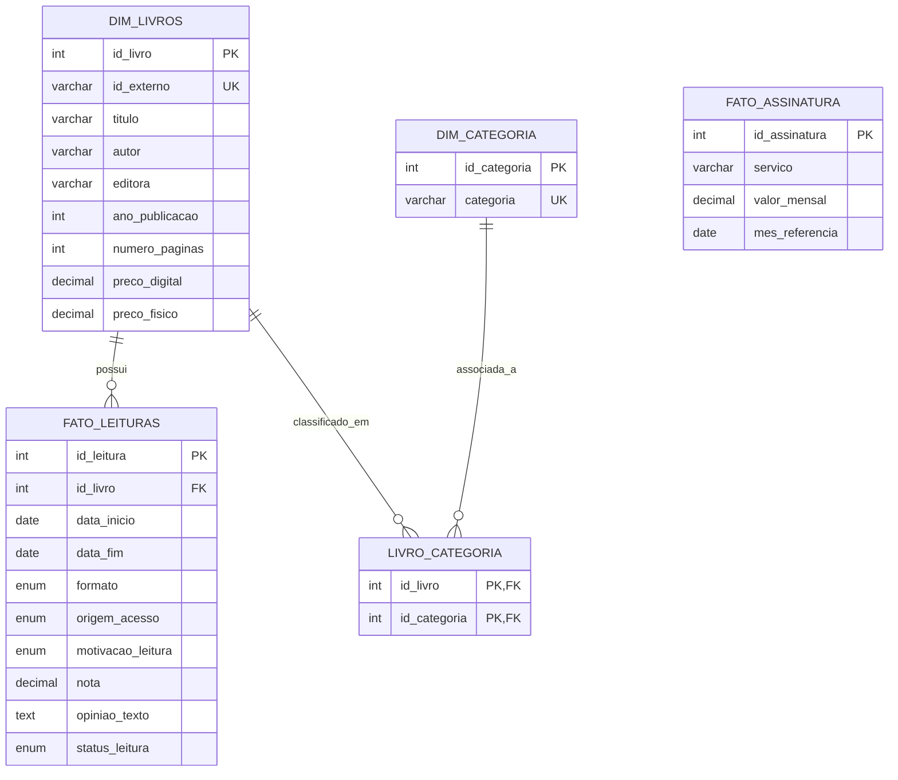

# Diagrama Entidade-Relacionamento (`book_analytics`)

O banco de dados book_analytics utiliza um modelo relacional composto por cinco tabelas, organizadas para armazenar informações dos livros, categorias, registros de leitura e histórico da assinatura Kindle+.

## 1. Diagrama ER

## 2. Descrição das entidades

| Tabela | Responsabilidade | Granularidade |
|---|---|---|
| `dim_livros` | Armazena os dados cadastrais e características dos livros. | Um registro por livro. |
| `dim_categoria` | Armazena as categorias literárias. | Um registro por categoria. |
| `livro_categoria` | Associa livros às respectivas categorias. | Uma associação entre livro e categoria por registro. |
| `fato_leituras` | Registra as ocorrências de leitura, incluindo datas, origem, formato e avaliação. | Um registro por evento de leitura. |
| `fato_assinatura` | Armazena o histórico de valores mensais da assinatura. | Um registro por serviço e data de referência. |

## 3. Relacionamentos

- **`dim_livros` → `fato_leituras` (1:N):** um livro pode possuir vários registros de leitura, enquanto cada registro de leitura está associado a um único livro.
- **`dim_livros` → `livro_categoria` (1:N):** um livro pode estar associado a várias categorias.
- **`dim_categoria` → `livro_categoria` (1:N):** uma categoria pode estar associada a vários livros.

A tabela `livro_categoria` resolve o relacionamento muitos-para-muitos entre livros e categorias por meio de uma chave primária composta por `id_livro` e `id_categoria`.

A tabela `fato_assinatura` não possui relacionamento físico com as demais tabelas. Seu histórico é utilizado de forma independente nas análises financeiras.

## 4. Regras de integridade

- `id_livro`, `id_categoria`, `id_leitura` e `id_assinatura` são chaves primárias.
- `id_externo` identifica externamente cada livro e possui restrição `UNIQUE`.
- `livro_categoria` possui chave primária composta por `id_livro` e `id_categoria`, impedindo a duplicidade de uma mesma associação.
- As chaves estrangeiras de `livro_categoria` referenciam `dim_livros` e `dim_categoria`.
- `fato_leituras.id_livro` referencia `dim_livros`.
- Os preços de referência e o número de páginas não podem assumir valores negativos ou inválidos, conforme as restrições `CHECK` definidas no banco.
- A nota deve estar entre 1,0 e 5,0. Pode permanecer nula quando não houver avaliação.
- A data de conclusão não pode ser anterior à data de início.
- O status `Lendo` exige `data_fim` nula, enquanto o status `Lido` exige `data_fim` preenchida.
- A tabela `fato_assinatura` possui uma restrição `UNIQUE` sobre a combinação de `servico` e `mes_referencia`.

**Observação:** a restrição de unicidade da assinatura considera a data completa de referência, não apenas o mês e o ano. Portanto, a padronização da data de referência é necessária para assegurar um único registro por mês.

## 5. Observações sobre a modelagem

- Os preços `preco_digital` e `preco_fisico` estão armazenados em `dim_livros` e representam valores de referência das edições, não necessariamente os valores efetivamente pagos.
- A tabela `fato_leituras` permite registrar mais de uma ocorrência de leitura para o mesmo livro.
- A tabela `livro_categoria` permite que um livro pertença a várias categorias e que uma categoria esteja associada a vários livros.
- A tabela `fato_assinatura` mantém o histórico dos valores mensais da assinatura Kindle+.