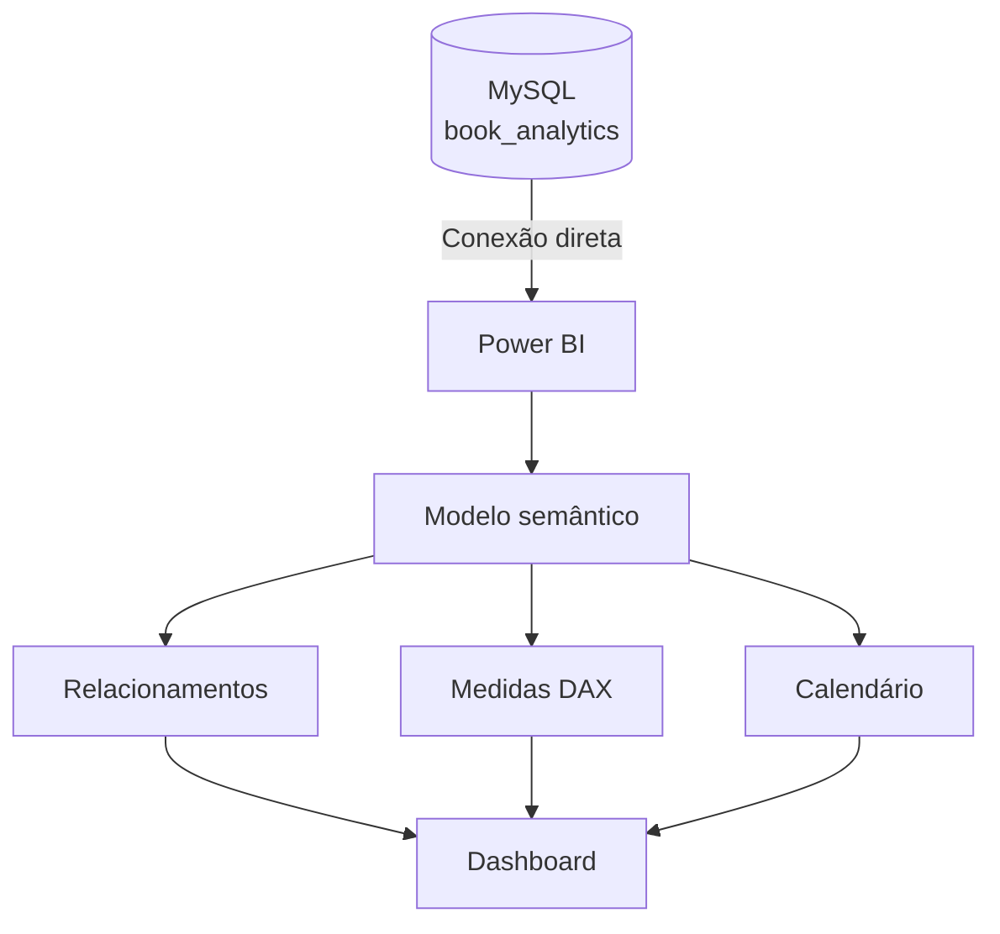

# Modelo Power BI — Kindle+

Este documento descreve a conexão entre o banco de dados `book_analytics` e o Power BI, a estrutura do modelo semântico, os relacionamentos, os cálculos em DAX e a organização analítica do dashboard.

## 1. Arquitetura e conexão dos dados

O Power BI utiliza conexão direta com o banco de dados MySQL `book_analytics`. Não são utilizadas views ou consultas intermediárias no banco para preparar os dados.

A modelagem, os relacionamentos, os filtros e os cálculos analíticos são realizados no próprio Power BI.



### Tecnologias e recursos

| Recurso | Utilização |
|---|---|
| MySQL | Armazenamento dos dados relacionais. |
| Power BI Desktop | Conexão, modelagem, cálculos e visualizações. |
| DAX | Criação de medidas e indicadores analíticos. |
| Power Query | Etapas de conexão e preparação dos dados, quando necessárias. |
| PBIP | Formato de projeto do relatório Power BI, utilizado para versionamento. |
| TMDL | Representação textual dos metadados do modelo semântico. |
| Git/GitHub | Versionamento dos arquivos do projeto. |

## 2. Estrutura do modelo semântico

O modelo semântico utiliza as tabelas do banco MySQL e uma tabela de calendário criada no Power BI.

### Tabelas utilizadas

| Tabela | Tipo | Responsabilidade |
|---|---|---|
| `dim_livros` | Dimensão | Cadastro de livros, autores, editoras e preços de referência. |
| `dim_categoria` | Dimensão | Cadastro das categorias literárias. |
| `livro_categoria` | Associativa | Relacionamento entre livros e categorias. |
| `fato_leituras` | Fato | Registro dos eventos de leitura, datas, origem, formato, motivação, nota e status. |
| `fato_assinatura` | Fato | Histórico dos valores mensais da assinatura Kindle+. |
| `Calendário` | Dimensão auxiliar | Análise temporal das leituras e dos custos da assinatura. |

### Granularidade das tabelas

- `dim_livros`: uma linha por livro cadastrado.
- `dim_categoria`: uma linha por categoria.
- `livro_categoria`: uma linha por associação entre livro e categoria.
- `fato_leituras`: uma linha por evento de leitura. Um mesmo livro pode aparecer em vários eventos.
- `fato_assinatura`: uma linha por serviço e data de referência.
- `Calendário`: uma linha por data do intervalo definido para as análises.

## 3. Relacionamentos

Os relacionamentos conectam as dimensões às tabelas de fatos e permitem analisar os registros por diferentes atributos.

### Relacionamentos implementados

| Tabela de origem | Tabela de destino | Cardinalidade | Direção de filtro | Status |
|---|---|---|---|---|
| `dim_livros` | `fato_leituras` | 1:N | Unidirecional (dimensão → fato) | Ativo |
| `dim_livros` | `livro_categoria` | 1:N | Bidirecional | Ativo |
| `Calendário` | `fato_leituras[data_fim]` | 1:N | Unidirecional (dimensão → fato) | Ativo |
| `Calendário` | `fato_leituras[data_inicio]` | 1:N | Unidirecional (dimensão → fato) | Inativo |
| `Calendário` | `fato_assinatura[mes_referencia]` | 1:N | Unidirecional (dimensão → fato) | Ativo |

**Observações:**

- O relacionamento entre `dim_livros` e `fato_leituras` permite analisar os eventos de leitura por atributos do livro.
- A tabela `livro_categoria` permite associar livros às respectivas categorias.
- A direção bidirecional entre `dim_livros` e `livro_categoria` permite que os filtros de categorias alcancem os livros relacionados.
- `fato_assinatura` não possui relacionamento direto com `fato_leituras`. As duas tabelas podem ser analisadas temporalmente por meio da tabela `Calendário`.

### Atenção ao relacionamento de datas

O relacionamento ativo entre `Calendário` e `fato_leituras` utiliza `data_fim`. Portanto, os filtros temporais aplicados pela tabela de calendário consideram a data de conclusão da leitura.

O relacionamento com `data_inicio` está inativo e pode ser ativado em medidas específicas utilizando `USERELATIONSHIP()`.

Exemplo:

```dax
Livros Iniciados =
CALCULATE(
    COUNTROWS('book_analytics fato_leituras'),
    USERELATIONSHIP(
        'Calendário'[Date],
        'book_analytics fato_leituras'[data_inicio]
    )
)
```

Essa distinção é importante porque uma análise por data de início não representa necessariamente o mesmo conjunto de registros de uma análise por data de conclusão.

Leituras em andamento e abandonadas sem `data_fim` não são associadas a uma data de conclusão no calendário.

## 4. Medidas e cálculos DAX

Os cálculos analíticos são desenvolvidos no Power BI, sem necessidade de criar views ou armazenar resultados agregados no MySQL.

As medidas DAX são utilizadas para construir indicadores, acompanhar tendências e responder às perguntas de negócio do projeto.

### Indicadores financeiros

O objetivo é avaliar o custo da assinatura e comparar o valor da versão digital com o custo hipotético de aquisição dos livros.

Indicadores considerados:

| Indicador | Objetivo |
|---|---|
| Mensalidade da assinatura | Acompanhar a evolução do preço mensal do Kindle+. |
| Total gasto com a assinatura | Calcular o custo acumulado no período. |
| Gastos efetivos com compras | Identificar os valores realmente pagos por livros adquiridos. |
| Valor de referência dos livros | Estimar o custo de aquisição avulsa dos livros lidos. |
| Economia estimada | Comparar o valor de referência dos livros com os custos da assinatura e das compras, conforme os critérios definidos. |
| Break-even acumulado | Identificar quando o valor de referência acumulado dos livros alcança ou supera o custo acumulado da assinatura. |

Exemplo de medida implementada:

```dax
Gastos Efetivos com Compras =
CALCULATE(
    SUM(fato_leituras[valor_pago]),
    fato_leituras[origem_acesso] = "Compra"
)
```

O break-even acumulado é utilizado como referência para avaliar a relação entre o custo da assinatura e o valor dos livros acessados por meio dela.

**Critério de interpretação:** o valor de referência de um livro não deve ser confundido com uma economia efetivamente realizada. A análise representa uma comparação hipotética com o preço de aquisição avulsa.

### Indicadores de comportamento de leitura

O objetivo é compreender como a assinatura se relaciona com os hábitos e as escolhas de leitura.

Indicadores considerados:

| Indicador | Objetivo |
|---|---|
| Livros concluídos | Acompanhar as leituras com status `Lido`. |
| Livros em andamento | Acompanhar as leituras com status `Lendo`. |
| Livros abandonados | Identificar leituras interrompidas. |
| Tempo médio de leitura | Analisar a duração média entre início e conclusão, quando as datas estiverem disponíveis. |
| Média de notas | Avaliar a satisfação com os livros avaliados. |

| Leituras por origem de acesso | Comparar livros obtidos por Kindle+, compra, empréstimo, presente ou cortesia. |
| Leituras por motivação | Comparar livros que já existiam na lista de interesses com aqueles sem intenção prévia de leitura. |

A coluna `motivacao_leitura` representa a existência de intenção prévia de ler o livro. Quando combinada com `origem_acesso`, permite investigar se a disponibilidade no Kindle+ influenciou a escolha de leitura.

### Indicadores de catálogo

O objetivo é conhecer o perfil dos livros registrados e a diversidade do catálogo utilizado.

Indicadores considerados:

- Quantidade de autores.
- Quantidade de editoras.
- Quantidade de categorias.

- Distribuição de livros por autor e editora.
- Distribuição de livros por categoria.
- Preços de referência dos livros por formato.

As contagens devem respeitar o contexto de filtro do relatório e considerar livros distintos quando a análise partir de `fato_leituras`, evitando duplicidades decorrentes de múltiplos eventos de leitura ou associações com categorias.

## 5. Organização analítica do dashboard

O dashboard deve responder a duas questões centrais:

1. Vale a pena continuar pagando pelo Kindle+?
2. Como a assinatura influencia meu comportamento de leitura?

A organização proposta contempla quatro áreas analíticas.

### Página 1 — Visão geral

Apresenta um resumo do desempenho da assinatura e do comportamento de leitura.

Indicadores principais:

- Total de livros lidos.
- Total de livros distintos.
- Total gasto com a assinatura.
- Valor de referência acumulado dos livros.
- Break-even acumulado.
- Meta anual de leitura e progresso.

Visualizações sugeridas:

- Evolução acumulada do custo da assinatura versus valor de referência dos livros.
- Evolução da quantidade de livros lidos ao longo do tempo.
- Distribuição das leituras por origem de acesso.
- Indicador de progresso da meta anual.

### Página 2 — Análise financeira

Investiga a relação entre o custo da assinatura e o valor dos livros acessados.

Indicadores principais:

- Mensalidade atual e histórico de mensalidades.
- Custo acumulado da assinatura.
- Gastos efetivos com compras.
- Valor de referência dos livros lidos.
- Economia estimada.
- Break-even acumulado.

Visualizações sugeridas:

- Evolução mensal do custo da assinatura.
- Comparação entre custo acumulado e valor de referência acumulado.
- Gastos por origem de acesso.
- Comparação entre preço digital e preço físico de referência.
- Evolução do saldo do break-even.

### Página 3 — Comportamento de leitura

Investiga frequência, preferências e características das leituras.

Indicadores principais:

- Livros iniciados e concluídos.
- Livros em andamento e abandonados.
- Média de notas.
- Tempo médio de leitura.
- Distribuição por origem de acesso.
- Distribuição por motivação.

Visualizações sugeridas:

- Evolução mensal das leituras.
- Distribuição dos status de leitura.
- Leituras por formato.
- Leituras por origem de acesso.
- Comparação entre intenção prévia e ausência de intenção.
- Distribuição das notas atribuídas.

### Página 4 — Catálogo e preferências

Apresenta as características dos livros lidos e as preferências literárias.

Indicadores principais:

- Total de autores.
- Total de editoras.
- Total de categorias.

Visualizações sugeridas:

- Ranking de autores.
- Ranking de editoras.
- Distribuição por categoria.
- Distribuição por quantidade de páginas.
- Distribuição por preço de referência.
- Livros mais bem avaliados.

## 6. Filtros e segmentações

Os filtros devem permitir explorar os indicadores por diferentes dimensões.

| Filtro | Finalidade |
|---|---|
| Ano | Analisar os resultados por período. |
| Origem de acesso | Comparar leituras do Kindle+, compras e demais origens. |
| Formato | Comparar livros digitais e físicos. |
| Status de leitura | Filtrar livros lidos, em andamento ou abandonados. |
| Motivação de leitura | Comparar livros com e sem intenção prévia. |


## 7. Estrutura e versionamento do projeto

O relatório é desenvolvido no formato Power BI Project (`.pbip`).

Esse formato permite manter os componentes do projeto em arquivos organizados e versionáveis, em vez de depender exclusivamente de um arquivo binário `.pbix`.

O modelo semântico é representado por arquivos TMDL, que permitem versionar e acompanhar alterações em tabelas, colunas, relacionamentos, medidas e demais metadados.

Os arquivos do projeto são mantidos no GitHub junto aos scripts SQL e à documentação.

## 8. Considerações e limitações analíticas

- O valor de referência dos livros representa uma estimativa de aquisição avulsa, não uma economia financeira comprovadamente realizada.
- Um mesmo livro pode possuir vários eventos de leitura; medidas de livros devem considerar a contagem distinta quando apropriado.
- Livros abandonados podem não possuir `data_fim`, o que exige atenção nas análises temporais baseadas na data de conclusão.
- A relação ativa do calendário com `data_fim` privilegia análises por conclusão. Análises por início devem ativar a relação inativa nas medidas correspondentes.
- A tabela `fato_assinatura` é independente da tabela `fato_leituras`; a análise conjunta depende da dimensão calendário.
- Indicadores de autores, editoras e categorias devem respeitar os filtros de origem de acesso sem gerar duplicidade ou perder registros.
- A meta anual de leitura é um parâmetro de acompanhamento e não deve ser confundida com o break-even financeiro.

## 9. Documentos relacionados

- [`README.md`](../README.md): apresentação geral do projeto e perguntas de negócio.
- [`diagrama-er.md`](diagrama-er.md): estrutura relacional do banco de dados.
- [`dicionario_de_dados.md`](dicionario_de_dados.md): descrição das tabelas, colunas e restrições.